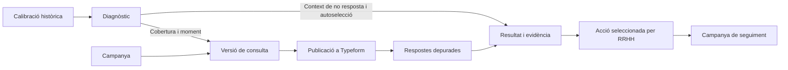

# Escolta activa Damm · Model lògic del prototip

El cas de demo és el canvi de torns en una planta fictícia. El diagnòstic orienta la difusió de la primera microconsulta i la calibració històrica ajuda a interpretar-ne la mostra. Les respostes de la microconsulta permeten a RRHH escollir una acció i obrir una segona onada per veure com evoluciona la percepció del canvi.

La guia del repte fixa els requisits i l’especificació de l’equip concreta el recorregut del model conceptual. Les decisions noves d’aquest model es presenten com a propostes per a la demo. [Guia del repte](../../../guia_participants_repte_damm.md) · [Especificació](../../../.plans/escolta-activa-damm-spec.md) · [Model conceptual](../../../model_conceptual_escolta_activa_damm.svg)

## Actors i límits

| Actor | Responsabilitat |
| --- | --- |
| RRHH | Defineix necessitat, públic i restriccions. Revisa i aprova la versió, decideix quan publicar-la i tria l’acció. |
| Persona participant | Obre el QR al mòbil i respon sense compte. El comentari i, si s’habilita, la declaració de torn són opcionals. |
| Plataforma | Valida, publica i importa des del servidor. Depura entrades, calcula agregats, aplica les regles de privacitat i conserva els vincles amb l’evidència. |
| Typeform | Allotja el formulari publicat i retorna les respostes de prova. |
| IA | Proposa preguntes i adaptacions, assenyala possibles problemes de redacció, proposa temes a partir de comentaris depurats i redacta síntesis i propostes vinculades a evidència publicable. |

## Entitats i relacions

Els identificadors i les cardinalitats descriuen les regles del domini. La tria del format de persistència queda pendent.

| Entitat | Dades mínimes i relacions |
| --- | --- |
| **Segment** | Identificador, sector, ubicació fictícia i torn quan pertoqui. El catàleg tancat valida les combinacions. El públic d’una campanya selecciona un o més segments compatibles. |
| **Calibració històrica** | Segment, període, població elegible, pregunta, escala i dues recollides sintètiques amb modalitat, canal, finestra, base vàlida i recomptes per puntuació. Es vincula al públic i es manté separada de les onades del canvi. La comparació opera sobre agregats. |
| **Campanya** | Identificador, objectiu, context, públic, finestra, durada màxima i temes a evitar. Cada campanya és una onada amb una o més versions. La de seguiment referencia l’acció que la va originar. |
| **Diagnòstic** | Instantània que vincula públic i troballes amb font, període, base, regla i limitació. Registra si la calibració correspon al públic exacte, és context d’un públic més ampli o és insuficient. Cada troballa té un identificador i es classifica com a senyal mesurat, risc o dades insuficients. Una versió referencia el diagnòstic que va motivar les adaptacions. |
| **Versió de consulta** | Clau `(campanya, número de versió)`, estat, títol, introducció, preguntes i ordre, branca, temps estimat, proposta de difusió i registre d’aprovació. L’aprovació fixa també el públic, la finestra i les restriccions que s’han revisat. |
| **Pregunta** | Dins la versió, identificador estable, posició, enunciat, tipus, opcions, obligatorietat i condició de salt si escau. Les dues preguntes de referència conserven la seva definició entre onades. |
| **Publicació** | Enllaç entre una versió aprovada i un formulari de Typeform, amb identificador extern únic, URL i correspondència entre camps externs i preguntes. El QR deriva de la URL. Proposta de demo: un formulari per onada i una versió per formulari. |
| **Resposta depurada** | Vinculada a la versió que s’ha respost. Identificador tècnic, origen, finestra de recollida, respostes per identificador de pregunta i torn declarat opcional. Pot incloure text depurat o només etiquetes temàtiques. Els imports de Typeform són únics per `(formulari, codi extern de resposta)`. Si s’habilita l’aparellament, conserva també un identificador intern de participació limitat a la sèrie. Les fixtures tenen claus i orígens propis. |
| **Resultat i evidència** | Instantània d’una onada amb període, segment, base, origen de les dades, regles d’anàlisi i diagnòstic històric aplicable. Cada troballa publicable té un identificador estable dins la instantània. L’acció conserva la referència a la troballa exacta encara que s’actualitzi el dashboard. |
| **Acció seleccionada** | Campanya d’origen, troballes publicables, acció concreta, rol responsable suggerit i punt a comprovar. Proposta de demo: una acció seleccionada per campanya, que dona lloc a un únic esborrany de seguiment. |

## Transicions i contractes

| Pas | Entrada → sortida | Condició |
| --- | --- | --- |
| **Preparar** | Necessitat + segment + calibració disponible → diagnòstic i versió en **esborrany** | El sistema cerca el públic aplicable, calcula els senyals i els mostra a RRHH. La IA proposa 3–6 preguntes i suggereix canal i finestra amb referències al diagnòstic de cobertura i moment. Un error d’IA permet reintentar o editar l’esborrany. |
| **Aprovar** | **Esborrany** → **aprovada** | RRHH aprova la versió exacta després de revisar el recorregut més llarg. El sistema valida format, preguntes fixes, opcions, salts i referències. Es comprova al mòbil que el recorregut més llarg dura menys de dos minuts. |
| **Editar després d’aprovar** | **Aprovada** → nova versió en **esborrany** | Es conserva la versió anterior com a registre i només es pot publicar la revisió vigent un cop aprovada. Amb una publicació ja activa, els canvis es preparen en una nova onada. |
| **Publicar** | Versió **aprovada** vigent → **publicada** + URL i QR | L’intent reserva l’onada i fixa la revisió que es publica. Mentre està pendent, es bloqueja crear una nova revisió o iniciar un altre intent. Si falla de manera confirmada, s’allibera la reserva i es conserva l’aprovació. Si es desconeix el resultat remot, cal reconciliar l’intent amb Typeform abans de continuar. |
| **Importar i analitzar** | Formulari vinculat + respostes → registres depurats i agregats contextualitzats | Import manual i repetible per RRHH. Validació contra la versió publicada i deduplicació pel codi tècnic. Aplicar les regles de privacitat abans de retornar resultats. Mostrar el contrast històric publicable al costat dels resultats observats. |
| **Escollir i seguir** | Evidència publicable → acció seleccionada i campanya de seguiment en **esborrany** | RRHH confirma l’acció. Repetir la creació recupera el mateix esborrany. El seguiment copia el públic i les dues preguntes fixes i torna a passar per aprovació. |

## Regles de mesura, privacitat i IA

- **Participació.** Taxa aparent = respostes vàlides del segment / població elegible del mateix segment i període. Amb un QR compartit, el codi extern identifica una tramesa. El torn sense declarar compta al total autoritzat i queda fora dels numeradors per torn. Si falten denominadors, la representativitat queda desconeguda. Si el numerador supera la població, es marca una incidència i se suprimeix la taxa.
- **Composició.** El pes d’un torn a la mostra i el seu pes a la població s’han de calcular sobre el mateix conjunt de torns. Si hi ha torns sense declarar, es mostra la base de torns coneguts quan és publicable i s’explica la limitació. El diagnòstic distingeix el desequilibri observat de la seva possible causa.
- **Contrast històric.** El percentatge de cada puntuació es calcula sobre les respostes vàlides a la pregunta en cada recollida. La diferència als extrems és el percentatge de puntuacions 1 o 5 de la voluntària menys el de la referència, en punts percentuals. Calen el mateix públic elegible, pregunta i escala i un període comparable. Entre plantes es pot comparar la magnitud del contrast quan els protocols siguin equivalents. Un avís de patró recurrent requereix diversos sondejos comparables.
- **Aplicació del context.** Associar la calibració pel sector i la ubicació. Si l’onada apunta a un torn i només hi ha dades de tota la fàbrica, indicar l’abast ampli de la referència. Sense calibració pertinent, retornar «Dades insuficients». El contrast de setembre aporta context a les interpretacions i es mostra separat de les mètriques de l’onada, que conserven els valors observats.
- **Protecció de resultats.** Aplicar `n ≥ 10` al servidor sobre la base efectiva de cada tall, mètrica i tema. Cada tema compta trameses diferents. Fer servir vistes predefinides i ocultar talls addicionals o agrupar si el total o altres talls permeten reconstruir una cel·la protegida. Aplicar la mateixa comprovació a les comparacions i actualitzacions visibles. Al dashboard arriben únicament agregats autoritzats i indicadors d’insuficiència.
- **Text lliure.** Abans de persistir text per a l’anàlisi o enviar-lo a la IA, eliminar dades identificatives o descartar el comentari si hi ha dubte. La resta de la resposta pot continuar sent vàlida. Els identificadors tècnics, el text cru i les metadades alienes al cas queden fora de les sortides i dels logs.
- **Comparació entre onades.** Comprensió i suport mantenen identificador, text, ordre, obligatorietat i escala d’1 a 5 a cada onada, amb «No ho puc valorar» com a categoria separada. Aquest valor queda fora del càlcul d’escala. Només mostrar la tendència directa si les preguntes són equivalents, el públic i el protocol són comparables i la base és publicable a cada onada. Mostrar les limitacions per canvis de composició o cobertura. La referència de l’acció és la primera microconsulta del canvi.
- **Comparació aparellada.** El servidor pot enllaçar puntuacions de la mateixa sèrie amb un codi opcional i calcular quants parells pugen, es mantenen o baixen. La vista de RRHH i l’entrada del LLM són agregades. [Regles de recuperació i aparellament](contracte-analisi-llm.md#comparació-amb-enquestes-anteriors)
- **Traçabilitat de la IA.** Validar estructura, restriccions, identificadors i suport semàntic abans de mostrar un bloc generat. Les accions només poden citar evidència publicable. Si la base és insuficient per sustentar una acció sobre el canvi, la sortida pot proposar millorar la recollida si hi ha evidència que ho justifiqui. [Protocol d’interpretació](protocol-interpretacio-llm.md)

## Comprovació amb dades sintètiques

| Cas | Resultat esperat |
| --- | --- |
| **Calibració.** Seleccionar la fàbrica del [sondeig sintètic de setembre](../../../.plans/escolta-activa-damm-spec.md#sondeig-sintètic-i-diagnòstic). | La voluntària mostra un 40% de participació aparent i 20,6 punts percentuals més als extrems. El gràfic mostra les dues bases i el diagnòstic diferencia el contrast mesurat del risc per a la consulta actual. |
| **Abast.** Seleccionar Nit amb calibració de tota la fàbrica, o seleccionar una altra ubicació sense calibració. | En el primer cas apareix l’avís d’abast ampli. En el segon es mostren dades insuficients per a aquella ubicació. |
| **Publicació.** RRHH edita una pregunta adaptable després d’aprovar. Després aprova el nou esborrany i torna a prémer publicar. | El formulari només es crea després de la segona aprovació. Les repeticions retornen el mateix formulari i el QR obre la versió publicada. |
| **Importació.** S’envia una resposta de prova pel QR i es recupera dues vegades. El comentari conté un telèfon fictici. | Es compta una tramesa vàlida en el registre intern. El telèfon es redacta o es descarta el comentari abans de l’anàlisi. Si el total exacte compromet una cel·la protegida, la vista publicada es manté suprimida o agrupada. |
| **Privacitat.** En una altra mostra, Dia té 44 respostes i Nit en té 9. | Amb el total de 53, cal ocultar el tall de Dia juntament amb el de Nit. Sense denominador, s’omet la taxa. |
| **Acció.** Almenys deu respostes diferents esmenten que les instruccions estan disperses i el tema supera les comprovacions de privacitat. | La proposta de resum a l’inici del torn referencia la troballa. RRHH la selecciona i obre un seguiment en esborrany. Una base de nou respostes vàlides en una pregunta fixa impedeix mostrar-ne la tendència. |

## Decisions per revisar amb l’equip

1. **Tall inicial.** Es proposa provar primer l’aprovació, el Typeform real, el QR i dues importacions de la mateixa resposta. A continuació, completar diagnòstic, resultats i seguiment amb dades sintètiques en el mateix recorregut.
2. **Mesura per torn.** Es proposa un QR compartit i torn autodeclarat opcional. Cal acordar les vistes predefinides, els denominadors disponibles i com es publiquen actualitzacions sense revelar cel·les protegides per diferència.
3. **Contractes del prototip.** Confirmar una publicació per onada i una acció amb seguiment per campanya. Un cop confirmat, concretar la reconciliació d’una publicació incerta, l’origen de les fixtures i les opcions de Typeform i d’IA.

El quiosc i Teams/M365 queden com a extensions de l’[especificació](../../../.plans/escolta-activa-damm-spec.md). L’[estudi d’IA](../../../IA%20en%20Enquestes%20de%20Clima.md) recull tècniques per valorar quan es concreti la implementació.
